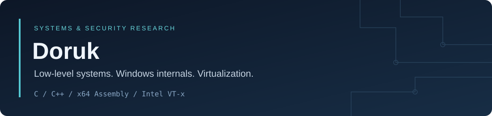

I work on low-level systems and Windows security research, using C, C++ and x64
assembly to understand how software interacts with the kernel and processor.
My work combines implementation, debugging and controlled experiments.

### Research interests

| Area | Focus |
| --- | --- |
| **Windows internals** | Virtual memory, process and thread structures, PE files, Native API and WinDbg |
| **Systems programming** | Kernel development, architectural state and C/assembly interfaces |
| **Virtualization** | Intel VT-x, per-CPU EPT, VM-exit handling and native execution transitions |
| **EDR research & evasion** | Endpoint telemetry, detection mechanisms and evasion techniques in controlled labs |

### Featured project

**[Velum-VMM](https://github.com/Dovughs/velum-vmm)**

A Windows x64 research hypervisor with EPT entry hooks, live kernel telemetry,
scoped request policies and an interactive console. Its C runtime and x64
assembly layer handle per-CPU VMX state, CET transfer and native shutdown.

[Source code](https://github.com/Dovughs/velum-vmm) | [Technical write-up](https://github.com/Dovughs/velum-vmm/blob/main/readmes/technical-writeup/README.md) | [Release](https://github.com/Dovughs/velum-vmm/releases/latest)

### Beyond systems

I also study advanced mathematics and history. I enjoy working through
mathematical ideas in depth and understanding historical events through their
sources and wider context.
